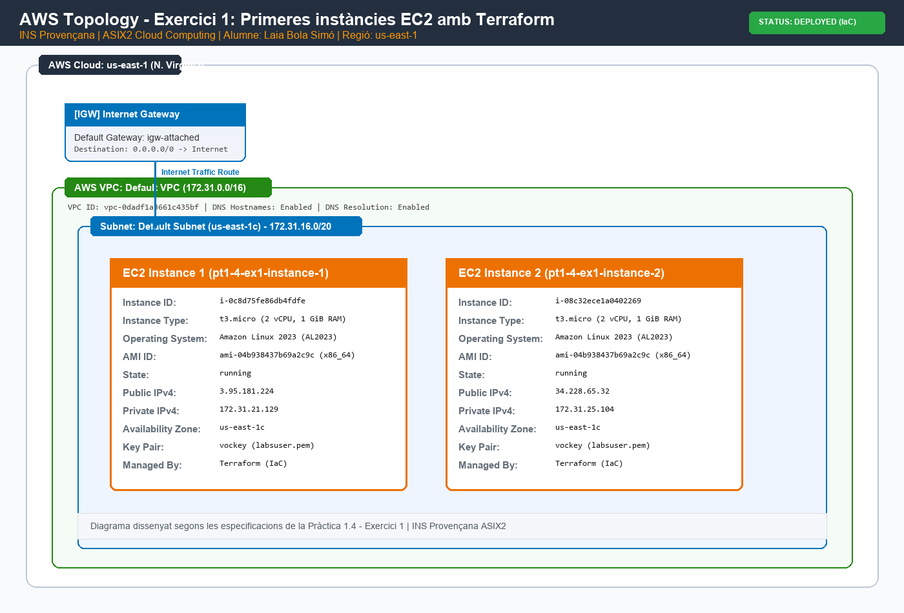

# Pràctica 1.4 - Exercici 1: Primeres instàncies EC2 amb Terraform

**Alumne:** Laia Bola Simó  
**Assignatura:** Mòdul OPT: Cloud Computing  
**Curs:** 2026-2027  
**Grup:** ASIX2  
**Centre:** INS Provençana  
**Professors:** Pedro Durán i Joan Muñoz  

---

## 1. Objectiu de la tasca

L'objectiu principal d'aquest exercici és iniciar-se en la **Infraestructura com a Codi (IaC)** mitjançant l'eina **Terraform**, automatitzant el provisionament i gestió de recursos computacionals bàsics al proveïdor de núvol **Amazon Web Services (AWS)**.

Especificacions dels recursos sol·licitats:
- **Nombre d'instàncies:** 2 instàncies EC2.
- **Tipus d'instància:** `t3.micro` (2 vCPU, 1 GiB RAM, arquitectura x86_64).
- **Sistema Operatiu:** `Amazon Linux 2023` (AL2023 AMI).
- **Regió AWS:** `us-east-1` (N. Virginia).

---

## 2. Diagrama de la topologia de xarxa

A continuació es mostra el diagrama de la topologia de xarxa generat seguint la iconografia oficial d'AWS:



### Descripció de la topologia:
- **Regió AWS:** `us-east-1` (N. Virginia).
- **VPC:** VPC per defecte del compte d'AWS (`172.31.0.0/16`), associada a un Internet Gateway que permet la connectivitat cap a l'exterior (`0.0.0.0/0`).
- **Instàncies EC2:**
  - `pt1-4-ex1-instance-1`: Instància `t3.micro` amb Amazon Linux 2023, IP privada `172.31.21.129` i IP pública `3.95.181.224`.
  - `pt1-4-ex1-instance-2`: Instància `t3.micro` amb Amazon Linux 2023, IP privada `172.31.25.104` i IP pública `34.228.65.32`.

---

## 3. Estructura de fitxers

Segons les normes de lliurament, l'estructura de carpetes d'aquest exercici és:

```
practiquescloud/
└── pt1-4-ex1/
    ├── assets/
    │   └── topologia.png
    ├── README.md
    └── main.tf
```

---

## 4. Explicació pas a pas del codi Terraform (`main.tf`)

El fitxer `main.tf` s'ha dissenyat de manera modular, neta i utilitzant variables per evitar valors fixos "hardcoded":

1. **Configuració de proveïdors (`terraform` i `provider "aws"`):**
   - Es defineix la versió mínima de Terraform (`>= 1.5.0`) i el provider oficial `hashicorp/aws` (`~> 5.0`).
   - La regió s'estableix mitjançant la variable `var.aws_region` amb valor per defecte `us-east-1`.

2. **Definició de Variables:**
   - `aws_region`: Permet canviar de regió fàcilment (`us-east-1`).
   - `instance_type`: Tipus de màquina (`t3.micro`).
   - `instance_count`: Quantitat d'instàncies a desplegar (`2`).

3. **Data Source per a l'AMI d'Amazon Linux 2023:**
   - Mitjançant `data "aws_ami" "amazon_linux_2023"`, Terraform consulta automàticament a l'API d'AWS la darrera imatge oficial d'Amazon Linux 2023 compatible amb arquitectura `x86_64` i virtualització `hvm`. Això garanteix que el codi sempre utilitzi una AMI vigent sense necessitat de modificar manualment els AMI IDs si s'actualitzen.

4. **Recurs `aws_instance`:**
   - S'utilitza el meta-argument `count = var.instance_count` per desplegar exactament les dues instàncies requerides.
   - S'etiqueten amb `Name = "pt1-4-ex1-instance-${count.index + 1}"`, l'entorn (`Laboratori`), el sistema operatiu i l'autora (`Laia Bola Simo`).
   - S'associa la clau SSH `vockey` pròpia del laboratori AWS Academy per a la connexió.

5. **Outputs:**
   - S'exporten informativament els IDs de les instàncies, les IPs públiques i les IPs privades obtingudes després del desplegament.

---

## 5. Guia d'execució del codi Terraform

Per a desplegar, verificar i destruir la infraestructura mitjançant el terminal, es segueixen els següents passos:

### Pas 1: Configuració prèvia de credencials AWS
Assegurar-se de tenir les credencials del laboratori d'AWS (AWS Academy o IAM User) carregades al fitxer `~/.aws/credentials` o mitjançant variables d'entorn:
```bash
aws sts get-caller-identity
```

### Pas 2: Inicialització (`terraform init`)
Inicialitza el directori de treball, descarregant el proveïdor d'AWS i configurant el backend local:
```bash
cd pt1-4-ex1
terraform init
```

### Pas 3: Validació i Planificació (`terraform plan`)
Genera i mostra el pla d'execució detallat, comprovant quins recursos seran creats sense aplicar canvis reals:
```bash
terraform plan
```

### Pas 4: Desplegament (`terraform apply`)
Aplica els canvis descrits al pla i aprovisiona les dues instàncies EC2 a AWS:
```bash
terraform apply -auto-approve
```
En finalitzar, Terraform retornarà els outputs amb els IDs de les màquines i les seves adreces IP:
```text
Outputs:

ami_id = "ami-04b938437b69a2c9c"
instance_ids = [
  "i-0c8d75fe86db4fdfe",
  "i-08c32ece1a0402269",
]
instance_private_ips = [
  "172.31.21.129",
  "172.31.25.104",
]
instance_public_ips = [
  "3.95.181.224",
  "34.228.65.32",
]
```

### Pas 5: Verificació de connectivitat (Opcional)
Es pot verificar la connectivitat SSH a les instàncies utilitzant la clau privada `labsuser.pem`:
```bash
ssh -i labsuser.pem ec2-user@3.95.181.224
```

### Pas 6: Destrucció dels recursos (`terraform destroy`)
Un cop finalitzada la pràctica i comprovades les instàncies, per evitar costos i estalviar crèdits al laboratori, s'alliberen tots els recursos creats:
```bash
terraform destroy -auto-approve
```
