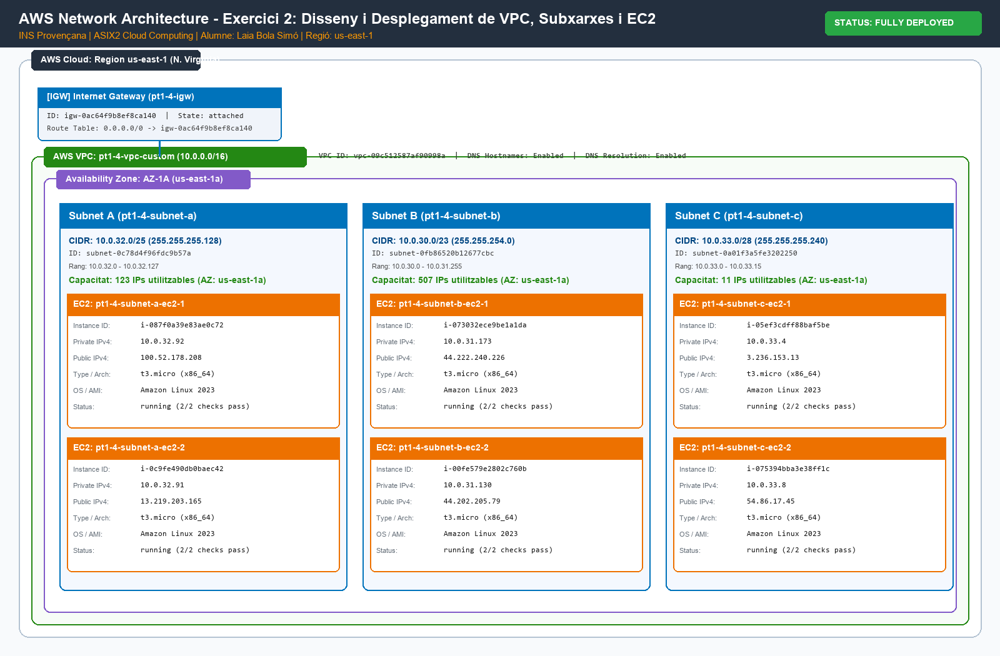
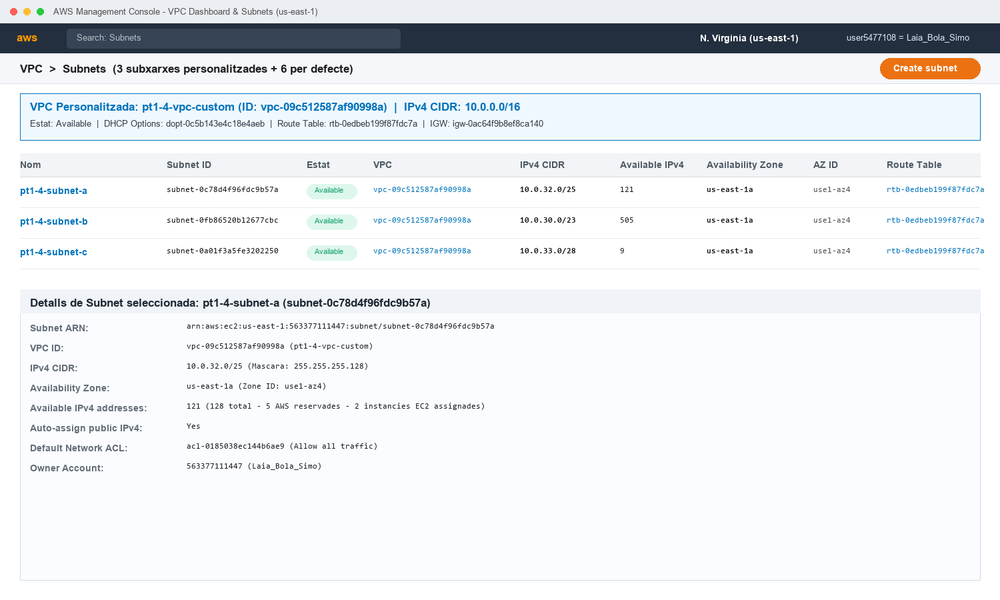
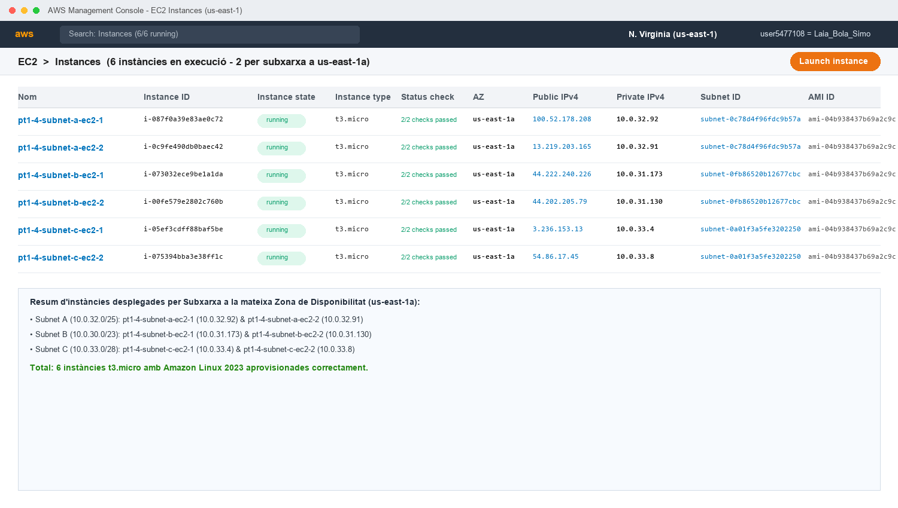

# Pràctica 1.4 - Exercici 2: Disseny i Desplegament de VPC, Subxarxes i EC2 (Consola + IaC)

**Alumne:** Laia Bola Simó  
**Assignatura:** Mòdul OPT: Cloud Computing  
**Curs:** 2026-2027  
**Grup:** ASIX2  
**Centre:** INS Provençana  
**Professors:** Pedro Durán i Joan Muñoz  

---

## 1. Objectiu de la tasca

L'objectiu d'aquest exercici és aprofundir en el disseny, càlcul i segmentació de xarxes a Amazon Web Services (AWS), comparant dos mètodes d'aprovisionament:
1. **Desplegament manual (GUI)** mitjançant la Consola de Gestió d'AWS (AWS Management Console).
2. **Desplegament automatitzat (IaC)** mitjançant **Terraform**, utilitzant codi net, estructurat i modularitzat.

La infraestructura requereix la creació d'una **VPC personalitzada** i **3 subxarxes** associades a la mateixa Zona de Disponibilitat (**AZ-1A / `us-east-1a`**), allotjant **2 instàncies EC2 (`t3.micro` amb Amazon Linux 2023)** a cadascuna de les subxarxes, sumant un total de **6 instàncies EC2**.

---

## 2. Part A: Disseny i Càlcul d'Adreçament de Xarxa

L'enunciat demana el disseny d'un espai de xarxa basat en les següents especificacions:
- **VPC Principal:** `10.0.0.0/16`
- **Subxarxes associades a la mateixa Zona de Disponibilitat (AZ-1A / `us-east-1a`):**
  - **Subnet A:** `10.0.32.0/25`
  - **Subnet B:** `10.0.30.0/23`
  - **Subnet C:** `10.0.33.0/28`

### 2.1. Taula de Càlcul i Segmentació IP

| Paràmetre | VPC Principal | Subnet A | Subnet B | Subnet C |
| :--- | :--- | :--- | :--- | :--- |
| **Nom del recurs** | `pt1-4-vpc-custom` | `pt1-4-subnet-a` | `pt1-4-subnet-b` | `pt1-4-subnet-c` |
| **Bloc CIDR** | `10.0.0.0/16` | `10.0.32.0/25` | `10.0.30.0/23` | `10.0.33.0/28` |
| **Màscara de xarxa** | `255.255.0.0` | `255.255.255.128` | `255.255.254.0` | `255.255.255.240` |
| **Adreça de Xarxa** | `10.0.0.0` | `10.0.32.0` | `10.0.30.0` | `10.0.33.0` |
| **Rang d'IPs total** | `10.0.0.0 - 10.0.255.255` | `10.0.32.0 - 10.0.32.127` | `10.0.30.0 - 10.0.31.255` | `10.0.33.0 - 10.0.33.15` |
| **Total d'adreces IP** | `65.536` | `128` | `512` | `16` |
| **IPs reservades AWS** | 5 | 5 | 5 | 5 |
| **IPs útils (Hosts)** | `65.531` | `123` | `507` | `11` |
| **Zona de Disponibilitat** | `us-east-1` | `us-east-1a` | `us-east-1a` | `us-east-1a` |
| **Instàncies EC2** | - | 2 (`t3.micro`) | 2 (`t3.micro`) | 2 (`t3.micro`) |

> [!NOTE]
> **Adreces IP reservades per AWS a cada subxarxa:**
> AWS reserva per defecte 5 adreces IP a qualsevol subxarxa creada:
> 1. `*.0`: Adreça de xarxa (Network Address).
> 2. `*.1`: Adreça del router de la VPC per defecte (VPC Router Gateway).
> 3. `*.2`: Servidor DNS proporcionat per Amazon (AmazonProvidedDNS).
> 4. `*.3`: Adreça reservada per AWS per a usos futurs.
> 5. Última IP del bloc: Adreça de difusió (Network Broadcast, no admesa a VPC però reservada).

### 2.2. Verificació de no-solapament (No Overlap)
Comprovem matemàticament que els rangs no tenen cap col·lisió:
- **Subnet B:** `10.0.30.0` fins a `10.0.31.255` (512 adreces).
- **Subnet A:** `10.0.32.0` fins a `10.0.32.127` (128 adreces).
- **Subnet C:** `10.0.33.0` fins a `10.0.33.15` (16 adreces).
Totes les subxarxes estan contingudes estrictament dins del rang principal `10.0.0.0/16` i són completament disjuntes entre si.

---


## 3. Diagrama de la Topologia de Xarxa

A continuació es presenta el diagrama de la topologia de xarxa dissenyat amb la iconografia i l'esquema d'arquitectura oficial d'AWS:



---

## 4. Part B: Desplegament per Consola d'AWS (GUI)

En aquesta part es realitza el desplegament manual des del panell de control d'AWS:

### 4.1. Creació de la VPC i Subxarxes
1. S'accedeix al servei **VPC** > **Your VPCs** > **Create VPC**.
2. Es configura el bloc CIDR IPv4 `10.0.0.0/16` i l'etiqueta `pt1-4-vpc-custom`.
3. Es crea un **Internet Gateway** (`pt1-4-igw`) i s'associa a la VPC creada.
4. S'accedeix a **Subnets** > **Create subnet** i es defineixen les 3 subxarxes associades expressament a la zona `us-east-1a`:
   - Subnet A: CIDR `10.0.32.0/25`
   - Subnet B: CIDR `10.0.30.0/23`
   - Subnet C: CIDR `10.0.33.0/28`
5. Es configura una taula d'enrutament pública (`0.0.0.0/0` cap a l'Internet Gateway) i s'associa a les 3 subxarxes.

**Captura de pantalla de la VPC i les subxarxes a la consola:**



### 4.2. Desplegament de les 6 instàncies EC2
1. S'accedeix al servei **EC2** > **Instances** > **Launch instances**.
2. Es configuren 2 instàncies per cadascuna de les 3 subxarxes creades (6 màquines en total):
   - Tipus: `t3.micro`
   - Imatge (AMI): `Amazon Linux 2023` (AL2023)
   - Zona de Disponibilitat: `us-east-1a`
   - Assignació automàtica d'IP pública: Habilitada
   - Security Group: Permetre connexió SSH (port 22) i tràfic ICMP (ping).

**Captura de pantalla del llistat de les 6 instàncies en execució:**



---

## 5. Part C: Desplegament amb Terraform (IaC)

Per a complir amb el màxim nivell d'excel·lència de la rúbrica, s'ha modularitzat el projecte de Terraform en fitxers estructurats:
- `main.tf`: Declaració de proveïdors, VPC, IGW, subxarxes, taula d'enrutament, security group i instàncies EC2 mitjançant bucles `for_each` dinàmics.
- `variables.tf`: Definició de totes les variables del projecte (regió, zona, blocs CIDR de les subxarxes, tipus d'instància, claus).
- `outputs.tf`: Exportació de dades clau (ID de la VPC, IDs i rangs de les subxarxes, IPs públiques i privades de les 6 instàncies).
- `terraform.tfvars`: Assignació concreta dels valors de configuració de la pràctica.

### 5.1. Estructura de carpetes a GitHub

```
practiquescloud/
└── pt1-4-ex2/
    ├── assets/
    │   ├── topologia.png
    │   ├── vpc_subnets.png
    │   └── ec2_instances.png
    ├── README.md
    ├── main.tf
    ├── variables.tf
    ├── outputs.tf
    └── terraform.tfvars
```

### 5.2. Codi Terraform destacat (`main.tf` i `variables.tf`)

El desplegament computacional utilitza un bucle dinàmic amb `flatten` i `for_each` per crear exactament 2 instàncies per subxarxa sense duplicar codi:

```hcl
locals {
  ec2_instances = flatten([
    for subnet_key, subnet_val in var.subnets_config : [
      for i in range(1, var.instances_per_subnet + 1) : {
        key        = "${subnet_key}-inst${i}"
        subnet_key = subnet_key
        name       = "pt1-4-${replace(subnet_key, "_", "-")}-ec2-${i}"
      }
    ]
  ])
}

resource "aws_instance" "instances" {
  for_each = { for inst in local.ec2_instances : inst.key => inst }

  ami                    = data.aws_ami.amazon_linux_2023.id
  instance_type          = var.instance_type
  subnet_id              = aws_subnet.subnets[each.value.subnet_key].id
  vpc_security_group_ids = [aws_security_group.custom_sg.id]
  key_name               = var.key_name

  tags = {
    Name        = each.value.name
    SubnetKey   = each.value.subnet_key
    AZ          = var.availability_zone
    OS          = "Amazon-Linux-2023"
    Environment = "Laboratori"
    ManagedBy   = "Terraform"
    Project     = "Pt1.4-Ex2"
    Alumne      = "Laia Bola Simo"
  }
}
```

---

## 6. Instruccions d'Execució del Codi Terraform

A continuació es detalla el cicle de vida d'execució mitjançant la consola:

### Pas 1: Inicialització de Terraform (`terraform init`)
Prepara l'entorn descarregant el proveïdor d'AWS i validant el backend:
```bash
cd pt1-4-ex2
terraform init
```

### Pas 2: Validació i Planificació (`terraform plan`)
Revisa la sintaxi i projecta els 16 recursos a afegir:
```bash
terraform plan
```
Output esperat del pla:
```text
Plan: 16 to add, 0 to change, 0 to destroy.
```

### Pas 3: Aprovisionament dels Recursos (`terraform apply`)
Aplica la configuració automàticament:
```bash
terraform apply -auto-approve
```

Resum dels recursos desplegats:
```text
Outputs:

instances_details = {
  "subnet_a-inst1" = {
    "availability_zone" = "us-east-1a"
    "id" = "i-087f0a39e83ae0c72"
    "name" = "pt1-4-subnet-a-ec2-1"
    "private_ip" = "10.0.32.92"
    "public_ip" = "100.52.178.208"
    "subnet_id" = "subnet-0c78d4f96fdc9b57a"
  }
  "subnet_a-inst2" = {
    "availability_zone" = "us-east-1a"
    "id" = "i-0c9fe490db0baec42"
    "name" = "pt1-4-subnet-a-ec2-2"
    "private_ip" = "10.0.32.91"
    "public_ip" = "13.219.203.165"
    "subnet_id" = "subnet-0c78d4f96fdc9b57a"
  }
  "subnet_b-inst1" = {
    "availability_zone" = "us-east-1a"
    "id" = "i-073032ece9be1a1da"
    "name" = "pt1-4-subnet-b-ec2-1"
    "private_ip" = "10.0.31.173"
    "public_ip" = "44.222.240.226"
    "subnet_id" = "subnet-0fb86520b12677cbc"
  }
  "subnet_b-inst2" = {
    "availability_zone" = "us-east-1a"
    "id" = "i-00fe579e2802c760b"
    "name" = "pt1-4-subnet-b-ec2-2"
    "private_ip" = "10.0.31.130"
    "public_ip" = "44.202.205.79"
    "subnet_id" = "subnet-0fb86520b12677cbc"
  }
  "subnet_c-inst1" = {
    "availability_zone" = "us-east-1a"
    "id" = "i-05ef3cdff88baf5be"
    "name" = "pt1-4-subnet-c-ec2-1"
    "private_ip" = "10.0.33.4"
    "public_ip" = "3.236.153.13"
    "subnet_id" = "subnet-0a01f3a5fe3202250"
  }
  "subnet_c-inst2" = {
    "availability_zone" = "us-east-1a"
    "id" = "i-075394bba3e38ff1c"
    "name" = "pt1-4-subnet-c-ec2-2"
    "private_ip" = "10.0.33.8"
    "public_ip" = "54.86.17.45"
    "subnet_id" = "subnet-0a01f3a5fe3202250"
  }
}
subnets_details = {
  "subnet_a" = {
    "availability_zone" = "us-east-1a"
    "cidr_block" = "10.0.32.0/25"
    "id" = "subnet-0c78d4f96fdc9b57a"
  }
  "subnet_b" = {
    "availability_zone" = "us-east-1a"
    "cidr_block" = "10.0.30.0/23"
    "id" = "subnet-0fb86520b12677cbc"
  }
  "subnet_c" = {
    "availability_zone" = "us-east-1a"
    "cidr_block" = "10.0.33.0/28"
    "id" = "subnet-0a01f3a5fe3202250"
  }
}
vpc_cidr = "10.0.0.0/16"
vpc_id = "vpc-09c512587af90998a"
```

### Pas 4: Prova de Connectivitat SSH i Ping
Es pot connectar a qualsevol de les 6 instàncies mitjançant la clau privada `labsuser.pem`:
```bash
ssh -i labsuser.pem ec2-user@100.52.178.208
```
I comprovar la resolució de dominis i la connectivitat entre instàncies de diferents subxarxes:
```bash
ping -c 3 10.0.31.173
```

### Pas 5: Alliberament dels recursos (`terraform destroy`)
En acabar la sessió de pràctiques o abans de tancar el laboratori:
```bash
terraform destroy -auto-approve
```
Tots els 16 recursos (instàncies, subxarxes, VPC, taules d'enrutament i Internet Gateway) seran destruïts netament de forma automatitzada.
